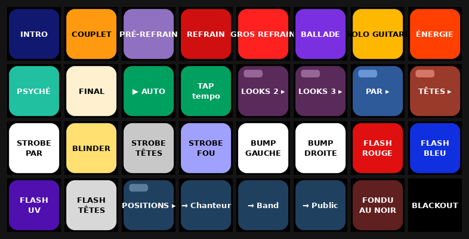

# Chauvet Intimidator Spot 260X — profil QLC+ et show rock

Profil de fixture QLC+ (`.qxf`) pour la Chauvet Intimidator Spot 260X, modes **14 Channel** et **8 Channel**, basé sur le manuel utilisateur 260X (Rev. 1).

## Installation du profil (Windows)
1. Télécharger `Chauvet-Intimidator-Spot-260X.qxf`
2. Le copier dans `Documents\QLC+\Fixtures` (créer le dossier au besoin)
3. Redémarrer QLC+ → Chauvet → Intimidator Spot 260X

---

# Show Rock — board QLC+ prêt à jouer


## Ouvrir le show
1. Télécharger le dossier `show/` au complet (le `.qxw` et le `.qxf` ensemble).
2. Dans QLC+ : **Fichier → Ouvrir** → `Show-Rock.qxw`.
   Le profil 260X est trouvé automatiquement s'il est installé ou s'il est dans le même dossier que le `.qxw`.
3. **Inputs/Outputs** → Universe 1 → vérifier que la sortie **DMX USB** (câble SH-RS09B) est cochée.
4. Cliquer sur le **▶ vert** (mode opération) et jouer dans la Virtual Console.

## Patch (Universe 1)

| Fixture | Profil / mode | Adresses DMX |
|---|---|---|
| Têtes 1 à 4 | Chauvet Intimidator Spot 260X — 14 Channel | 1, 15, 29, 43 |
| PAR 1 à 4 (gauche → droite) | Blizzard Lighting Hotbox EXA — 11 Channel Mode | 66, 77, 88, 99 |

Sur chaque PAR : menu → mode **11CH** et l'adresse de la table.

## Comment jouer
1. **Choisis un LOOK** dans les 3 rangées du haut (30 looks) : tout le rig change d'un coup, avec des fondus.
   Ou appuie sur **▶ AUTO** : les looks s'enchaînent tout seuls aux 16 temps.
2. **Raffine en live** : une couleur PAR, un gobo, une position ou un mouvement par-dessus le look. Le bouton remplace juste cette partie-là.
3. **Tape le beat** sur TEMPO : les effets PAR et les mouvements suivent la toune.
4. **Fin de toune** : FONDU AU NOIR (2 s) ou BLACKOUT.

## Les looks

| Look | PAR | Têtes |
|---|---|---|
| **INTRO** | Bleu nuit + UV | Bleu, gobo 2 qui tourne, balayage lent sur le public |
| **COUPLET** | Ambre | CTO ouvert sur le band |
| **PRÉ-REFRAIN** | Alterné ambre/bleu (tempo) | Magenta, gobo 3, en éventail, vague de tilt |
| **REFRAIN** | Rouge | Blanc gobo 1, croisées, en huit |
| **GROS REFRAIN** | Pair/impair rouge-blanc (tempo) | Blanc + prisme, éventail, ballyhoo |
| **BALLADE** | Plasma lent | Magenta, gobo 5 qui tourne, sur le chanteur |
| **SOLO GUITARE** | Rouge sang | Blanc ouvert au centre |
| **ÉNERGIE** | Vague rouge (tempo) | Rouge, gobo 4 en rotation rapide, V inversé, cercle |
| **PSYCHÉ** | Arc-en-ciel | Arc-en-ciel, gobo 6, prisme, ballyhoo au plafond |
| **FINAL** | Blanc chaud | Blanc sur le public |

**Rangée 2**

| Look | PAR | Têtes |
|---|---|---|
| **OUVERTURE** | Blanc froid | Blanc ouvert, balayage lent sur le public |
| **FEU** | Remplir du centre orange (tempo) | Orange, gobo 4 qui tourne, vague de tilt sur le band |
| **OCÉAN** | Vague bleue (tempo) | Cyan, gobo 2 qui tourne, balayage lent |
| **DISCO** | Chase couleurs (tempo) | Chase couleurs, gobo 7, prisme, cercle au plafond |
| **SOMBRE** | UV | Bleu, gobo 5, prisme, balayage lent |
| **ROCK BLANC** | Blanc froid | Blanc gobo 1, croisées, en huit |
| **ACOUSTIQUE** | Bords bleus / centre ambre | CTO ouvert sur le chanteur |
| **MONTÉE** | Un par un (tempo) | Jaune, gobo 3 rapide, éventail, vague de tilt |
| **CHAOS** | Pair/impair (tempo) | Chase couleurs + chase gobos, prisme, ballyhoo |
| **APOTHÉOSE** | Arc-en-ciel | Blanc + prisme, éventail, ballyhoo |

**Rangée 3**

| Look | PAR | Têtes |
|---|---|---|
| **SPOT CHANTEUR** | Bleu nuit | Blanc ouvert, les 4 sur le chanteur |
| **SOLO BATTERIE** | Pair/impair (tempo) | Rouge, gobo 1 rapide, sur la batterie, cercle |
| **SOLO BASSE** | Mauve | Magenta, gobo 3 qui tourne, sur la basse |
| **COUCHER SOLEIL** | Orange | Orange, gobo 5 qui tourne, éventail, balayage lent |
| **NÉON** | Magenta / cyan | Cyan, gobo 7, prisme, plafond, cercle |
| **TEMPÊTE** | Strobe aléatoire | Blanc, gobo 6 rapide, croisées, huit |
| **ROUGE & UV** | Rouge / UV | Rouge, gobo 2 qui tourne, public, vague tilt |
| **BLEU GLACE** | Cyan | Bleu, gobo 2, V inversé, balayage lent |
| **FEU D'ARTIFICE** | Arc-en-ciel | Chase couleurs + gobos, prisme, ballyhoo |
| **ENTRACTE** | Bleu nuit | Bleu, gobo 5 lent au plafond, balayage lent |

## La Virtual Console

| Zone | Ce que ça fait |
|---|---|
| **PAR — Couleurs** | 14 couleurs + 6 combinaisons (pair/impair, bords/centre). Fondu de 0,4 s entre les couleurs. |
| **PAR — Effets** | Vagues, pair/impair, alterné, un par un, remplir du centre, arc-en-ciel, plasma, chase, fondu lent |
| **Masters & tempo** | Fader **PAR** et fader **TÊTES** (dimmers). **TEMPO** : tape le beat sur *Tap*. |
| **Flash** (maintenir) | Strobe PAR `S`, Blinder `B`, Strobe têtes `D`, Strobe fou `F` |
| **Urgence** | **BLACKOUT** `X`, **FONDU AU NOIR** `N` (arrête tout en 2 s) |
| **Flash & bumps** (maintenir) | Bump gauche `1`, bump droite `2`, flash rouge `3`, bleu `4`, UV `5`, flash têtes `6` |
| **Têtes — Couleur / Gobo / FX** | Roue de couleurs, 7 gobos + ouvert, rotation lente/rapide, prisme, chase couleurs, chase gobos |
| **Têtes — Position** | 8 positions avec fondu de 1,2 s + **pad XY** pour viser en live |
| **Têtes — Mouvement** | Cercle, huit, balayage lent, vague tilt, diamant, ballyhoo. Ils sont **relatifs** : ils bougent autour de la position active, alors garde toujours une position allumée. |

Les têtes s'allument dès que tu choisis une couleur ou un gobo, parce que ces scènes ouvrent le shutter.

## Stream Deck

### Profil prêt à importer (Stream Deck XL)


1. Télécharge **`show/Show-Rock-XL.streamDeckProfile`**.
2. Double-clique dessus (ou Stream Deck → Préférences → Profils → Importer).
3. Choisis le profil **Show Rock (QLC+)** pour ton XL.

Page principale : les 10 looks de la rangée 1, AUTO, TAP, les strobes **on/off** (un appui = on, un autre = off), les bumps et flashs, 3 positions rapides, FONDU et BLACKOUT. Les dossiers **LOOKS 2**, **LOOKS 3**, **PAR**, **TÊTES** et **POSITIONS** contiennent tout le reste.

Le profil est généré par `tools/make_streamdeck.py` à partir du show : relance-le après chaque changement de raccourcis.

### Les raccourcis
Chaque bouton du board a un raccourci clavier. Sur le Stream Deck : glisse l'action **Système → Raccourci (Hotkey)** sur une touche et tape la combinaison du tableau.

- QLC+ doit être **en avant-plan** et en **mode show (▶)** : le raccourci va à la fenêtre active.
- Astuce : mets le nom du look et sa couleur comme titre/fond de la touche Stream Deck.
- Les flashs (strobe, blinder, bumps) marchent tant que la touche est tenue.


**LOOKS DU SHOW — un bouton = tout le rig  **

| Bouton | Touche |
|---|---|
| INTRO | `F1` |
| COUPLET | `F2` |
| PRÉ-REFRAIN | `F3` |
| REFRAIN | `F4` |
| GROS REFRAIN | `F5` |
| BALLADE | `F6` |
| SOLO GUITARE | `F7` |
| ÉNERGIE | `F8` |
| PSYCHÉ | `F9` |
| FINAL | `F10` |
| OUVERTURE | `Shift+F1` |
| FEU | `Shift+F2` |
| OCÉAN | `Shift+F3` |
| DISCO | `Shift+F4` |
| SOMBRE | `Shift+F5` |
| ROCK BLANC | `Shift+F6` |
| ACOUSTIQUE | `Shift+F7` |
| MONTÉE | `Shift+F8` |
| CHAOS | `Shift+F9` |
| APOTHÉOSE | `Shift+F10` |
| SPOT CHANTEUR | `Ctrl+F1` |
| SOLO BATTERIE | `Ctrl+F2` |
| SOLO BASSE | `Ctrl+F3` |
| COUCHER SOLEIL | `Ctrl+F4` |
| NÉON | `Ctrl+F5` |
| TEMPÊTE | `Ctrl+F6` |
| ROUGE & UV | `Ctrl+F7` |
| BLEU GLACE | `Ctrl+F8` |
| FEU D'ARTIFICE | `Ctrl+F9` |
| ENTRACTE | `Ctrl+F10` |
| ▶ AUTO | `F11` |

**PAR — COULEURS**

| Bouton | Touche |
|---|---|
| Rouge | `Alt+A` |
| Rouge sang | `Alt+B` |
| Orange | `Alt+C` |
| Ambre | `Alt+D` |
| Or | `Alt+E` |
| Blanc chaud | `Alt+F` |
| Blanc froid | `Alt+G` |
| Cyan | `Alt+H` |
| Bleu | `Alt+I` |
| Bleu nuit | `Alt+J` |
| Mauve | `Alt+K` |
| Magenta | `Alt+L` |
| Vert | `Alt+M` |
| UV | `Alt+N` |
| Rouge / Ambre | `Alt+O` |
| Bleu / Ambre | `Alt+P` |
| Rouge / Bleu | `Alt+Q` |
| Magenta / Cyan | `Alt+R` |
| Bords bleus | `Alt+S` |
| Bords rouges | `Alt+T` |

**PAR — EFFETS**

| Bouton | Touche |
|---|---|
| Vague rouge | `Alt+Shift+A` |
| Vague bleue | `Alt+Shift+B` |
| Pair / Impair | `Alt+Shift+C` |
| Alterné ambre/bleu | `Alt+Shift+D` |
| Un par un | `Alt+Shift+E` |
| Remplir centre | `Alt+Shift+F` |
| Arc-en-ciel | `Alt+Shift+G` |
| Plasma lent | `Alt+Shift+H` |
| Chase couleurs | `Alt+Shift+I` |
| Fondu lent | `Alt+Shift+J` |

**MASTERS & TEMPO**

| Bouton | Touche |
|---|---|
| TAP tempo | `T` |
| STROBE PAR | `S` |
| BLINDER | `B` |
| STROBE TÊTES | `D` |
| STROBE FOU | `F` |
| BLACKOUT | `X` |
| FONDU AU NOIR | `N` |

**TÊTES — COULEUR**

| Bouton | Touche |
|---|---|
| Blanc | `Ctrl+Shift+A` |
| Rouge | `Ctrl+Shift+B` |
| Orange | `Ctrl+Shift+C` |
| Jaune | `Ctrl+Shift+D` |
| Vert | `Ctrl+Shift+E` |
| Bleu | `Ctrl+Shift+F` |
| CTO | `Ctrl+Shift+G` |
| Cyan | `Ctrl+Shift+H` |
| Magenta | `Ctrl+Shift+I` |
| Arc-en-ciel | `Ctrl+Shift+J` |

**TÊTES — GOBO**

| Bouton | Touche |
|---|---|
| Ouvert | `Ctrl+Shift+K` |
| Gobo 1 | `Ctrl+Shift+L` |
| Gobo 2 | `Ctrl+Shift+M` |
| Gobo 3 | `Ctrl+Shift+N` |
| Gobo 4 | `Ctrl+Shift+O` |
| Gobo 5 | `Ctrl+Shift+P` |
| Gobo 6 | `Ctrl+Shift+Q` |
| Gobo 7 | `Ctrl+Shift+R` |

**TÊTES — FX**

| Bouton | Touche |
|---|---|
| Rotation gobo | `Ctrl+Shift+T` |
| Rotation rapide | `Ctrl+Shift+U` |
| Prisme | `Ctrl+Shift+V` |
| Chase couleurs | `Ctrl+Shift+W` |
| Chase gobos | `Ctrl+Shift+Y` |

**TÊTES — POSITION**

| Bouton | Touche |
|---|---|
| Centre | `Shift+A` |
| Public | `Shift+B` |
| Band | `Shift+C` |
| Chanteur | `Shift+D` |
| Croisé | `Shift+E` |
| Éventail | `Shift+F` |
| V inversé | `Shift+G` |
| Batterie | `Shift+H` |
| Guitare | `Shift+I` |
| Basse | `Shift+J` |
| Plafond | `Shift+K` |

**TÊTES — MOUVEMENT**

| Bouton | Touche |
|---|---|
| Cercle | `Shift+L` |
| Huit | `Shift+M` |
| Balayage lent | `Shift+N` |
| Vague tilt | `Shift+O` |
| Diamant | `Shift+P` |
| Ballyhoo | `Shift+Q` |

**FLASH & BUMPS**

| Bouton | Touche |
|---|---|
| BUMP GAUCHE | `G` |
| BUMP DROITE | `H` |
| FLASH ROUGE | `J` |
| FLASH BLEU | `K` |
| FLASH UV | `L` |
| FLASH TÊTES | `M` |

## Anti-bug : la scène BASE
Certains canaux (strobe des PAR, prisme, rotation de gobo, shutter des têtes) gardent leur dernière valeur quand un flash ou un bouton s'arrête. La scène **BASE (toujours active)** démarre toute seule en mode show et fait partie de chaque look : elle remet ces canaux à zéro dès qu'un flash est relâché.
Après un **FONDU AU NOIR**, relance un look avant d'utiliser les flashs (le fondu arrête aussi BASE).

## Positions des têtes
Les 8 positions sont **calculées à partir du plan de la salle** (têtes en ligne au-dessus du public, Tête 1 près de la scène) :
- têtes à **11 pi** du sol et scène à **2 pi** (valeurs supposées : `H_LIGHTS` et `H_STAGE` dans `tools/generate_show.py`) ;
- sens du pan vérifié dans la salle (`PAN_SIGN = -1`).

## Lekos
Pas encore dans le show : il faut ajouter leurs adresses.

## Regénérer le show
```
python3 tools/generate_show.py
```
Les adresses, couleurs et positions sont en haut du script.
