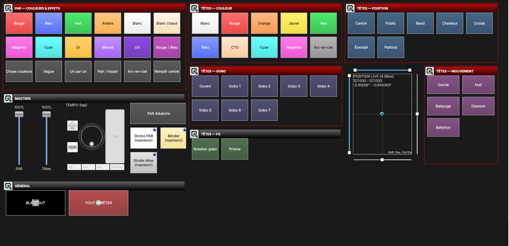

# Chauvet Intimidator Spot 260X — profil QLC+ et show rock

Profil de fixture QLC+ (`.qxf`) pour la Chauvet Intimidator Spot 260X, modes **14 Channel** et **8 Channel**, basé sur le manuel utilisateur 260X (Rev. 1).

## Installation du profil (Windows)
1. Télécharger `Chauvet-Intimidator-Spot-260X.qxf`
2. Le copier dans `Documents\QLC+\Fixtures` (créer le dossier au besoin)
3. Redémarrer QLC+ → Chauvet → Intimidator Spot 260X

---

# Show Rock — board QLC+ prêt à jouer



## Ouvrir le show
1. Télécharger le dossier `show/` au complet (le `.qxw` et le `.qxf` ensemble).
2. Dans QLC+ : **Fichier → Ouvrir** → `Show-Rock.qxw`.
   Le profil 260X est trouvé automatiquement s'il est installé ou s'il est dans le même dossier que le `.qxw`.
3. **Inputs/Outputs** → Universe 1 → vérifier que la sortie **DMX USB** (câble SH-RS09B) est cochée.
4. Cliquer sur le **▶ vert** (mode opération) et jouer dans la Virtual Console.

## Patch (Universe 1)

| Fixture | Profil / mode | Adresses DMX |
|---|---|---|
| Têtes 1 à 4 | Chauvet Intimidator Spot 260X — 14 Channel | 1, 15, 29, 43 |
| PAR 1 à 12 (gauche → droite) | Blizzard Lighting Hotbox EXA — 11 Channel Mode | 66, 77, 88, 99, 110, 121, 132, 143, 154, 165, 176, 187 |

Sur chaque PAR : menu → mode **11CH** et l'adresse de la table.

## La Virtual Console

| Zone | Ce que ça fait |
|---|---|
| **PAR — Couleurs & effets** | 12 couleurs + 6 effets (chase, vague, un par un, pair/impair, arc-en-ciel, remplir du centre). Un seul look à la fois. |
| **Masters** | Fader **PAR** (dimmer des 12 PAR) et fader **Têtes**. **TEMPO** : tape le beat sur *Tap* pour synchroniser chases, effets et mouvements. |
| **Flash** (maintenir) | Strobe PAR `S`, Blinder `B`, Strobe têtes `D`, PAR Aléatoire |
| **Général** | **BLACKOUT** `X`, **TOUT ARRÊTER** |
| **Têtes — Couleur / Gobo / FX** | Roue de couleurs, 7 gobos + ouvert, rotation gobo, prisme |
| **Têtes — Position** | 7 positions de départ + **pad XY** pour viser en live |
| **Têtes — Mouvement** | Cercle, Huit, Balayage, Diamant, Ballyhoo. Ces mouvements sont **relatifs** : ils bougent autour de la position active, alors garde toujours une position allumée. |

Les têtes s'allument dès que tu choisis une couleur ou un gobo, parce que ces scènes ouvrent le shutter.

## À ajuster sur place
- **Positions** : les valeurs pan/tilt sont des points de départ. Dans **Functions → Têtes/Positions**, ouvre la scène et ajuste les têtes pendant qu'elles sont allumées.
- **Ordre des têtes** : le show suppose que Tête 1 (adresse 1) est à gauche. Sinon, change l'adresse dans **Fixtures**.
- **Lekos** : pas encore dans le show. Il faut ajouter leurs adresses.

## Regénérer le show
```
python3 tools/generate_show.py
```
Les adresses, couleurs et positions sont en haut du script.
